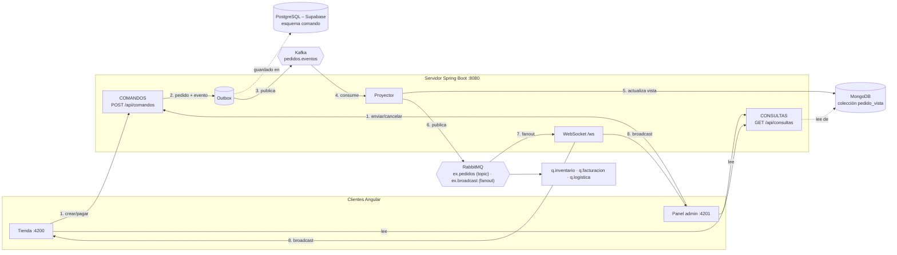

# Tienda en vivo – CQRS + Kafka + RabbitMQ + WebSocket

Proyecto de **Sistemas Distribuidos** (Universidad Central). Una tienda de pedidos con:

- **Servidor** en Java (Spring Boot) → carpeta [`backend/`](backend)
- **Dos aplicaciones cliente** en Angular, independientes del servidor → [`frontend/`](frontend): **Tienda** y **Panel de administración**
- **CQRS**: comandos (escribir) y consultas (leer) separados
- **Kafka** (eventos entre comandos y consultas) y **RabbitMQ** (enrutamiento y broadcast)
- **Broadcast en vivo** por WebSocket a todos los clientes conectados
- **Dos motores de base de datos**: **PostgreSQL en la nube (Supabase)** para comandos y **MongoDB** para consultas

 **[Requerimientos](docs/REQUERIMIENTOS.md)** (incluye en qué se coloca cada tema y por qué) ·  

## Arquitectura



### Opción A: todo con Docker (un solo comando)

```bash
copy .env.example .env      # en Linux/Mac: cp .env.example .env  (y pon tus datos de Supabase)
docker compose --profile app up -d --build
```

Tienda: http://localhost:4200 · Panel: http://localhost:4201 · RabbitMQ: http://localhost:15672 (guest / guest)

### Opción B: Docker solo para Kafka y RabbitMQ, y el resto desde tu IDE

Necesitas además **JDK 21+**, **Maven** y **Node 20+**.

```bash
# 1) Kafka y RabbitMQ
docker compose up -d

# 2) Servidor (define antes las variables de .env.example)
cd backend
mvn spring-boot:run

# 3) Clientes (en otras dos terminales)
cd frontend
npm install
npx ng serve tienda      # http://localhost:4200
npx ng serve admin       # http://localhost:4201

## Estructura

```
backend/    Servidor Spring Boot (comando/, consulta/, mensajeria/, evento/, config/)
frontend/   Workspace Angular: projects/tienda, projects/admin, projects/shared
docs/       Requerimientos, wiki y guía de GitHub
docker-compose.yml   Kafka + RabbitMQ y, con el perfil app, también servidor y clientes
```

## Tecnologías

Java 21 · Spring Boot 3.3 · Spring Kafka · Spring AMQP · Spring WebSocket (STOMP) · Spring Data JPA · Spring Data MongoDB · Flyway · PostgreSQL (Supabase) · MongoDB · Angular 18 · RxJS · @stomp/stompjs · Docker Compose · GitHub Actions
