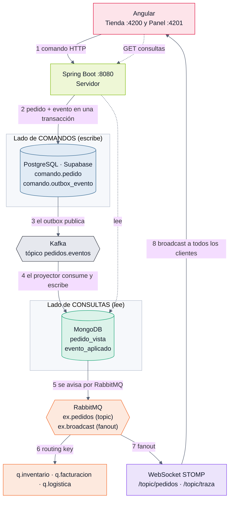
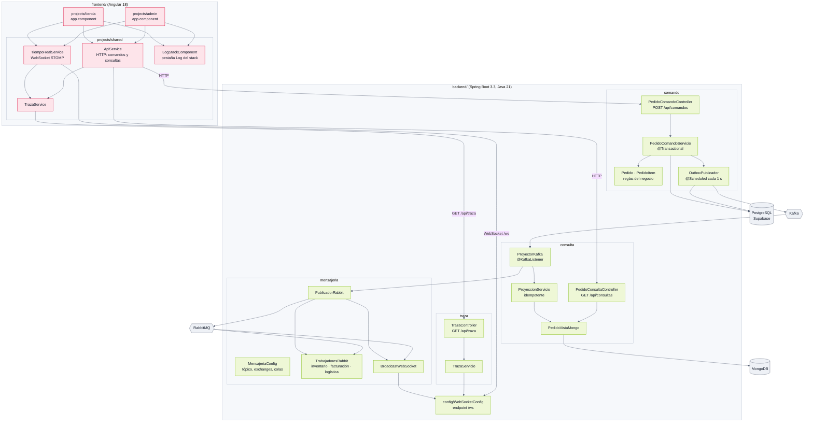
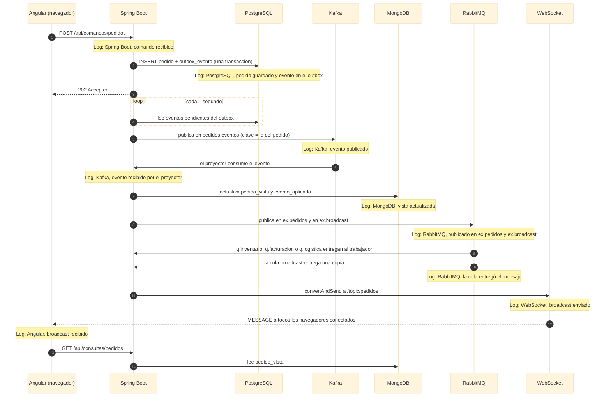

# Tienda en vivo: CQRS + Kafka + RabbitMQ + WebSocket

Proyecto de **Sistemas Distribuidos** (Universidad Central). Es una tienda de pedidos en línea hecha para ver, funcionando, cómo se combinan un servidor, dos aplicaciones cliente, dos bases de datos y dos sistemas de mensajería.

- **Servidor** en Java (Spring Boot) en [`backend/`](backend).
- **Dos aplicaciones cliente** en Angular, independientes del servidor, en [`frontend/`](frontend): la **Tienda** y el **Panel de administración**.
- **CQRS:** los comandos (escribir) y las consultas (leer) están separados en código, en API y en base de datos.
- **Kafka** lleva los eventos entre el lado de comandos y el de consultas. **RabbitMQ** los enruta a colas de trabajo y hace el broadcast.
- **Broadcast en vivo** por WebSocket: un cambio hecho en una pantalla aparece en todas las demás.
- **Dos motores de base de datos:** PostgreSQL en la nube (Supabase) para comandos y MongoDB para consultas.
- **Pestaña "Log del stack":** muestra en tiempo real el momento exacto en que se usa cada herramienta.

[Requerimientos](docs/REQUERIMIENTOS.md) (qué se coloca dónde y por qué) · Wiki (páginas en [`docs/wiki`](docs/wiki)) · [Cómo publicarlo en GitHub](docs/PUBLICAR_EN_GITHUB.md)

## Contenido

1. [Arquitectura](#arquitectura)
2. [Diagrama de componentes](#diagrama-de-componentes)
3. [Recorrido de un pedido](#recorrido-de-un-pedido)
4. [Log del stack en vivo](#log-del-stack-en-vivo)
5. [El stack, herramienta por herramienta](#el-stack-herramienta-por-herramienta)
6. [Tablas de referencia](#tablas-de-referencia)
7. [Inicio rápido](#inicio-rápido)
8. [Guion para probarlo y sustentarlo](#guion-para-probarlo-y-sustentarlo)
9. [Estructura del repositorio](#estructura-del-repositorio)

## Arquitectura

Los números siguen el recorrido de un pedido. Son los mismos pasos que aparecen, en el mismo orden, en la pestaña **Log del stack** y en la franja de herramientas que hay arriba de ella (Angular, Spring Boot, PostgreSQL, Kafka, MongoDB, RabbitMQ, WebSocket).



La idea central: **escribir y leer no usan lo mismo.** Un comando se guarda en PostgreSQL. Después, un evento viaja por Kafka y actualiza una copia ya preparada para mostrar en MongoDB. Las consultas leen solo de esa copia. Entre el comando y la consulta pasa un instante (consistencia eventual), y el broadcast avisa a las pantallas cuando la copia ya está lista.

## Diagrama de componentes

Qué hay dentro de cada parte y quién habla con quién. Las clases que ves aquí son las que existen en el código.



| Parte | Responsabilidad |
|---|---|
| `comando/` | Recibe los comandos, aplica las reglas del pedido y guarda pedido y evento en una sola transacción. El `OutboxPublicador` pasa los eventos a Kafka. |
| `consulta/` | El `ProyectorKafka` consume los eventos y el `ProyeccionServicio` actualiza MongoDB. El controlador de consultas solo lee de MongoDB. |
| `mensajeria/` | Declara el tópico, los exchanges y las colas. Publica en RabbitMQ, consume las colas de trabajo y hace el broadcast por WebSocket. |
| `traza/` | Registra cada vez que se usa una herramienta y lo emite al log del stack. |
| `config/` | WebSocket (STOMP en `/ws`), CORS y manejo de errores. |
| `frontend/projects/shared` | Código que comparten las dos apps: llamadas HTTP, conexión WebSocket, servicio y componente del log. |

## Recorrido de un pedido

Lo mismo en forma de secuencia. Cada nota amarilla es una línea que verás en el log.



## Log del stack en vivo

Está en la pestaña **Log del stack**, tanto en la Tienda como en el Panel. Sirve para ver, y para explicarle a alguien, **en qué momento se usa cada herramienta**.

**Cómo se lee**

- Arriba hay una franja con las siete herramientas, en el orden del diagrama de arquitectura. Cuando una herramienta se usa, **se ilumina** un instante y su contador sube.
- Abajo está la lista de líneas, la más nueva arriba. Cada línea tiene la hora (con milisegundos), la herramienta, qué pasó y el detalle técnico (tópico, routing key, tabla, colección).
- Puedes **filtrar por herramienta**, **pausar** para leer con calma, **limpiar**, y pulsar el código de un pedido para **ver solo su recorrido**.

**Cómo funciona por dentro**

1. Cada clase del servidor llama a `TrazaServicio.registrar(...)` justo cuando usa su herramienta.
2. El servicio guarda la línea en memoria (las últimas 300) y la emite por WebSocket a `/topic/traza`.
3. El navegador recibe cada línea al instante. Si abres la pestaña tarde, el historial se carga con `GET /api/traza`.
4. Las líneas de **Angular** las genera el propio navegador: cuando envía un comando y cuando recibe el broadcast.
5. Las líneas de PostgreSQL se emiten **después del commit**, así el log nunca muestra un "guardado" que se revirtió.

**Qué línea sale de dónde**

| Herramienta | Línea del log | Quién la emite |
|---|---|---|
| Angular | Comando enviado: crear / pagar / enviar / cancelar | `ApiService` |
| Angular | Broadcast recibido en este navegador | `TiempoRealService` |
| Spring Boot | Comando recibido | `PedidoComandoServicio` |
| PostgreSQL | Pedido guardado o actualizado | `PedidoComandoServicio` |
| PostgreSQL | Evento guardado en el outbox | `PedidoComandoServicio` |
| Kafka | Evento publicado en Kafka (con partición y offset) | `OutboxPublicador` |
| Kafka | Evento recibido por el proyector | `ProyectorKafka` |
| Kafka | Kafka no responde / volvió a responder | `OutboxPublicador` |
| MongoDB | Vista actualizada, o evento repetido que se ignora | `ProyeccionServicio` |
| MongoDB | Consulta leída / resumen calculado | `PedidoConsultaController` |
| RabbitMQ | Publicado en `ex.pedidos` (con su routing key y la cola destino) | `PublicadorRabbit` |
| RabbitMQ | Publicado en `ex.broadcast` | `PublicadorRabbit` |
| RabbitMQ | Cola `q.inventario` / `q.facturacion` / `q.logistica` entregó el mensaje | `TrabajadoresRabbit` |
| RabbitMQ | Cola broadcast entregó una copia | `BroadcastWebSocket` |
| WebSocket | Broadcast enviado a todos los clientes | `BroadcastWebSocket` |

Las lecturas a MongoDB se agrupan (como mucho una línea cada 1,5 segundos), porque cada pantalla vuelve a consultar con cada broadcast y llenaría el log de líneas iguales.

## El stack, herramienta por herramienta

### Angular 18 (los clientes)

- **Qué es:** el framework de las dos aplicaciones web que ve el usuario.
- **Para qué lo usamos:** son **dos aplicaciones aparte**, independientes del servidor y entre sí: la **Tienda** (catálogo, recibo, mis pedidos) y el **Panel** (todos los pedidos, filtro por estado, pagar, enviar, cancelar). Las dos comparten el código de `projects/shared`.
- **Qué hacen:** envían comandos por HTTP, leen consultas por HTTP, y mantienen una conexión WebSocket abierta para actualizarse solas.
- **En el log:** aparece como **Angular** cuando envía un comando y cuando recibe el broadcast.

### Spring Boot 3.3 (el servidor)

- **Qué es:** el framework de Java con el que está hecho el servidor.
- **Para qué lo usamos:** recibe los comandos y las consultas, aplica las reglas del negocio y conecta con las bases de datos y los mensajeros. Cada integración es un módulo de Spring: **Spring Data JPA** (PostgreSQL), **Spring Data MongoDB**, **Spring for Apache Kafka**, **Spring AMQP** (RabbitMQ), **Spring WebSocket** (STOMP) y **Actuator** (`/actuator/health`).
- **Reglas del pedido** (en la entidad `Pedido`): avanza `CREADO` → `PAGADO` → `ENVIADO`. Se puede cancelar mientras esté `CREADO` o `PAGADO`. Si se intenta algo que no corresponde (por ejemplo, enviar un pedido sin pagar), responde `409`.
- **En el log:** aparece como **Spring Boot** cuando recibe un comando.

### PostgreSQL en Supabase (la base de comandos)

- **Qué es:** una base de datos relacional. Supabase la aloja en la nube.
- **Para qué la usamos:** es el lado que **escribe**. Guarda los pedidos (`comando.pedido`, `comando.pedido_item`) y la tabla **outbox** (`comando.outbox_evento`).
- **Por qué PostgreSQL aquí:** necesitamos transacciones. Guardar el pedido y su evento tiene que ocurrir **completo o no ocurrir**.
- **Flyway:** crea las tablas al arrancar el servidor (`V1__esquema.sql`). Nadie las crea a mano.
- **Conexión:** se usa el *Session pooler* de Supabase (puerto 5432). Los datos van en el `.env`, que nunca se sube a GitHub.
- **En el log:** aparece como **PostgreSQL** cuando guarda el pedido y cuando guarda el evento en el outbox.

### Kafka (los eventos entre comandos y consultas)

- **Qué es:** un registro distribuido y duradero de eventos, ordenado.
- **Para qué lo usamos:** es el **puente de CQRS**. Lleva cada cambio de un pedido desde el lado de comandos hasta el de consultas.
- **Cómo está armado:**
  - **Tópico:** `pedidos.eventos`, con 3 particiones y 1 réplica.
  - **Clave del mensaje:** el id del pedido. Kafka manda todos los eventos de un mismo pedido a la **misma partición**, así llegan en el orden en que ocurrieron (creado, pagado, enviado).
  - **Productor:** el `OutboxPublicador`, que cada segundo publica los eventos pendientes del outbox, en orden.
  - **Consumidor:** el `ProyectorKafka`, en el grupo `proyector-pedidos`.
  - **Si el consumidor falla,** reintenta cada 2 segundos **sin saltarse el mensaje** (así no se pierde ni se desordena nada).
- **Por qué Kafka y no solo RabbitMQ:** Kafka conserva los eventos. Si hay que reconstruir la base de consultas, se pueden volver a leer desde el principio.
- **En el log:** aparece como **Kafka** cuando se publica el evento (con partición y offset) y cuando el proyector lo recibe.

### MongoDB (la base de consultas)

- **Qué es:** una base de datos de documentos.
- **Para qué la usamos:** es el lado que **lee**. Cada pedido es un documento en `pedido_vista`, con sus ítems adentro. Una sola lectura trae lo que necesita la pantalla, sin uniones.
- **Colecciones:**
  - `pedido_vista`: los pedidos listos para mostrar.
  - `evento_aplicado`: los eventos ya procesados. Hace al proyector **idempotente**: si Kafka entrega dos veces el mismo evento, la segunda se ignora.
- **En el log:** aparece como **MongoDB** cuando el proyector actualiza la vista y cuando se lee una consulta.

### RabbitMQ (colas, enrutamiento y broadcast)

- **Qué es:** un mensajero que enruta mensajes con **exchanges**, **routing keys** y **colas** (el mismo modelo del proyecto NBA).
- **Para qué lo usamos:** dos cosas.
  1. **Colas de trabajo.** Cada evento se publica en el exchange `ex.pedidos` (tipo **topic**) con una routing key, y el exchange lo manda a la cola que corresponda.
  2. **Broadcast.** Cada evento también se publica en `ex.broadcast` (tipo **fanout**), que entrega una **copia a cada servidor** conectado.
- **Exchanges:**

| Exchange | Tipo | Qué hace |
|---|---|---|
| `ex.pedidos` | topic | Enruta según la routing key del mensaje. |
| `ex.broadcast` | fanout | Copia el mensaje a todas las colas conectadas, sin mirar la routing key. |

- **Colas y bindings:**

| Evento | Routing key | Cola | Quién la consume y qué hace |
|---|---|---|---|
| Pedido creado | `pedido.creado` | `q.inventario` | Inventario: reserva el stock |
| Pedido cancelado | `pedido.cancelado` | `q.inventario` | Inventario: devuelve el stock |
| Pedido pagado | `pedido.pagado` | `q.facturacion` | Facturación: genera la factura |
| Pedido enviado | `pedido.enviado` | `q.logistica` | Logística: despacha el pedido |
| Todos | (no usa) | `q.broadcast.<id>` | El servidor la convierte en broadcast por WebSocket |

- **La cola broadcast** es propia de cada instancia del servidor (nombre único, se borra sola al desconectarse). Así, si hubiera dos servidores, los dos recibirían la copia.
- **Los mensajes** viajan en JSON (el evento completo: id, tipo, pedido, cliente, total, estado, ítems y hora).
- **Panel web:** http://localhost:15672 (usuario `guest`, clave `guest`).
- **En el log:** aparece como **RabbitMQ** cuando se publica en cada exchange y cuando cada cola entrega el mensaje.

### WebSocket con STOMP (el broadcast hacia el navegador)

- **Qué es:** una conexión que se queda abierta entre el navegador y el servidor. STOMP le agrega destinos y suscripciones.
- **Para qué lo usamos:** el navegador no habla con Kafka ni con RabbitMQ. El servidor **empuja** cada cambio a todos los navegadores suscritos, sin que ellos pregunten cada pocos segundos (sin *polling*).
- **Endpoint:** `ws://servidor:8080/ws`.
- **Destinos:**

| Destino | Qué llega |
|---|---|
| `/topic/pedidos` | Cada cambio de un pedido, con el pedido y el resumen por estado |
| `/topic/traza` | Cada línea del log del stack |

- **En el log:** aparece como **WebSocket** cuando el servidor envía el broadcast.

### Docker y Docker Compose

- **Para qué los usamos:** levantar Kafka, RabbitMQ y MongoDB (y, con el perfil `app`, también el servidor y las dos apps) con un solo comando, sin instalar nada de eso en el equipo.

### GitHub Actions

- **Para qué lo usamos:** en cada cambio compila el servidor, ejecuta sus pruebas y compila las dos aplicaciones.

## Patrones de diseño

| Patrón | Dónde | Para qué |
|---|---|---|
| **CQRS** | Todo el servidor, en `comando/` y `consulta/` | Escribir y leer con modelos, APIs y bases de datos distintos. |
| **Outbox** | Tabla `comando.outbox_evento` y `OutboxPublicador` | Guardar el evento en la **misma transacción** que el pedido y publicarlo en Kafka después, con reintentos. Si Kafka está caído, el evento espera y no se pierde. |
| **Proyector idempotente** | `ProyeccionServicio` y la colección `evento_aplicado` | Poder repetir un evento sin duplicar nada. |
| **Consistencia eventual** | Los comandos responden `202 Accepted` | La vista se actualiza un instante después; el broadcast avisa cuando ya está. |

## Tablas de referencia

**API REST** (puerto 8080)

| Método y ruta | Lado | Qué hace |
|---|---|---|
| `POST /api/comandos/pedidos` | Comandos | Crea un pedido (responde `202`) |
| `POST /api/comandos/pedidos/{id}/pagar` | Comandos | Marca el pedido como pagado |
| `POST /api/comandos/pedidos/{id}/enviar` | Comandos | Marca el pedido como enviado (solo si está pagado) |
| `POST /api/comandos/pedidos/{id}/cancelar` | Comandos | Cancela el pedido (solo si no se envió) |
| `GET /api/consultas/pedidos?estado=&cliente=` | Consultas | Lista pedidos desde MongoDB |
| `GET /api/consultas/pedidos/{id}` | Consultas | Un pedido |
| `GET /api/consultas/resumen` | Consultas | Cantidad de pedidos por estado |
| `GET /api/traza` | Log | Últimas 300 líneas del log del stack |
| `GET /actuator/health` | Salud | `{"status":"UP"}` si el servidor está sano |

**Almacenamiento**

| Dónde | Qué guarda |
|---|---|
| PostgreSQL, esquema `comando` | `pedido`, `pedido_item`, `outbox_evento` |
| MongoDB, base `tienda` | `pedido_vista`, `evento_aplicado` |

**Puertos** (con Docker)

| Servicio | Puerto |
|---|---|
| Tienda | 4200 |
| Panel | 4201 |
| Servidor | 8080 |
| Kafka | 9092 |
| RabbitMQ | 5672 (panel web 15672) |
| MongoDB | 27017 |

## Inicio rápido

Necesitas **Docker Desktop** y una base en **Supabase** para los comandos (guía: [`docs/wiki/Base-de-datos-Supabase.md`](docs/wiki/Base-de-datos-Supabase.md)). MongoDB, Kafka y RabbitMQ los trae Docker.

### Opción A: todo con Docker (un solo comando)

```bash
copy .env.example .env      # en Linux o Mac: cp .env.example .env
# Edita .env y pon tus datos de Supabase (DB_URL, DB_USER, DB_PASSWORD)
docker compose --profile app up -d --build
```

Haz el `copy` **solo la primera vez**: si ya tienes un `.env` configurado, lo sobrescribiría con los valores de ejemplo.

Tienda: http://localhost:4200 · Panel: http://localhost:4201 · RabbitMQ: http://localhost:15672 (guest / guest)

### Opción B: Docker solo para Kafka, RabbitMQ y MongoDB, y el resto desde el IDE

Necesitas además **JDK 21 o superior**, **Maven** y **Node 20 o superior**.

```bash
# 1) Kafka, RabbitMQ y MongoDB
docker compose up -d

# 2) Servidor (define antes las variables de .env.example)
cd backend
mvn spring-boot:run

# 3) Clientes (en otras dos terminales)
cd frontend
npm install
npx ng serve tienda --port 4200
npx ng serve admin --port 4201
```

Guía paso a paso, con Windows y sin Docker: [`docs/wiki/Instalacion-y-ejecucion.md`](docs/wiki/Instalacion-y-ejecucion.md).

La dirección del servidor que usan los clientes está en [`frontend/projects/shared/src/config.ts`](frontend/projects/shared/src/config.ts). Si el servidor corre en otro puerto o en otro equipo, cambia solo la línea `SERVIDOR`, y agrega el origen de los clientes a `CORS_ORIGENES`.

## Guion para probarlo y sustentarlo

1. Abre la **Tienda** en dos pestañas y el **Panel** en otra ventana. Las tres dicen *Conectado en vivo*.
2. En la Tienda escribe un nombre, agrega productos y pulsa **Hacer pedido**. Aparece en todas las pantallas sin recargar.
3. Abre la pestaña **Log del stack** y haz otro pedido. Mira cómo se van iluminando las herramientas, de izquierda a derecha: Angular, Spring Boot, PostgreSQL, Kafka, MongoDB, RabbitMQ y WebSocket.
4. En el Panel pulsa **Marcar pagado** y luego **Enviar**. En el log verás que cada estado usa **otra cola** de RabbitMQ (`q.facturacion` al pagar, `q.logistica` al enviar).
5. **Mira cada pieza por dentro:**
   - **Supabase:** Table Editor, esquema `comando`, tablas `pedido`, `pedido_item` y `outbox_evento`.
   - **MongoDB** (Compass, `mongodb://localhost:27017`): base `tienda`, colecciones `pedido_vista` y `evento_aplicado`.
   - **Kafka:** `docker exec -it kafka /opt/kafka/bin/kafka-console-consumer.sh --bootstrap-server localhost:9092 --topic pedidos.eventos --from-beginning`
   - **RabbitMQ:** http://localhost:15672, pestañas *Exchanges* y *Queues*. Las colas casi siempre se ven en 0 porque el servidor consume al instante. Para ver el contenido de los mensajes, crea una cola de prueba (`q.prueba`) y conéctala a `ex.pedidos` con la routing key `#`; luego usa *Get messages*.
6. **Tolerancia a fallos (outbox):** apaga Kafka (`docker stop kafka`) y crea un pedido. Se guarda en PostgreSQL, pero no aparece en las pantallas. En el log verás *Kafka no responde*. Enciende Kafka (`docker start kafka`): en unos segundos el evento se publica y el pedido aparece.

## Estructura del repositorio

```
backend/    Servidor Spring Boot (comando/, consulta/, mensajeria/, traza/, evento/, config/)
frontend/   Workspace Angular: projects/tienda, projects/admin, projects/shared
docs/       Requerimientos, wiki y guía de GitHub
docker-compose.yml   Kafka, RabbitMQ y MongoDB y, con el perfil app, también servidor y clientes
```

## Tecnologías

Java 21 · Spring Boot 3.3 · Spring Kafka · Spring AMQP · Spring WebSocket (STOMP) · Spring Data JPA · Spring Data MongoDB · Flyway · PostgreSQL (Supabase) · MongoDB · Kafka · RabbitMQ · Angular 18 · RxJS · @stomp/stompjs · Docker Compose · GitHub Actions

## Limitaciones

- No hay autenticación: el nombre del cliente solo sirve para filtrar sus pedidos.
- No hay pagos reales: "Pagar" solo cambia el estado.
- Inventario, facturación y logística solo escriben en el log lo que harían.
- El log del stack guarda en memoria las últimas 300 líneas; si el servidor se reinicia, se vacía.
